# 02 — Trend Joining Levels (TJL1 / TJL2 A+)

## Rules practised
- After every BOS: **TJL1** = zone at level 1 (the broken confirmed high/low), **TJL2 (A+)** = zone at level 2 (last support/resistance).
- Buy pullbacks into TJL1/TJL2 in bullish structure, sell in bearish. Zone = wick + 1% of body.
- Trade TJL1 only after a strong impulse; otherwise wait for TJL2.
- Invalidation: close beyond level 2 (that is a CHOCH).

## How it was tested
- Pairs: AUDUSD, USDCAD, NZDUSD, EURJPY, USDCHF, GBPJPY (none on your watchlist). Data: Dukascopy bid, times in IST.
- Each setup is traded two ways: **raw** = limit order at the zone edge, SL beyond the zone (+0.1 ATR); **confirmed** = wait for price to touch the zone, then the first engulfing candle on the lower timeframe (D1→H1, H4→M15, H1→M5, M15→M1), market entry at its close, SL beyond the touch swing (+0.1 ATR).
- Target 1:3 (course examples ~1:3). A setup is cancelled if a candle closes through its invalidation level before entry. `hit1R%`/`hit2R%` = how often price reached 1R/2R before the stop (useful if you'd book earlier).
- Break-even win rate at 1:3 is 25%.

## Results by timeframe
| tf | method | trades | wins | losses | win% | net_R | R/trade | hit1R% | hit2R% |
|---|---|---|---|---|---|---|---|---|---|
| D1 | confirmed | 14 | 4 | 10 | 28.6 | 2.0 | 0.14 | 40.0 | 40.0 |
| D1 | raw | 88 | 18 | 70 | 20.5 | -16.0 | -0.18 | 41.0 | 21.0 |
| H1 | confirmed | 197 | 54 | 143 | 27.4 | 19.0 | 0.1 | 56.8 | 40.7 |
| H1 | raw | 422 | 94 | 328 | 22.3 | -46.0 | -0.11 | 46.6 | 29.2 |
| H4 | confirmed | 50 | 10 | 40 | 20.0 | -10.0 | -0.2 | 52.0 | 32.0 |
| H4 | raw | 228 | 47 | 181 | 20.6 | -40.0 | -0.18 | 43.3 | 27.6 |
| M15 | confirmed | 692 | 172 | 520 | 24.9 | -4.0 | -0.01 | 51.2 | 33.4 |
| M15 | raw | 774 | 185 | 589 | 23.9 | -34.0 | -0.04 | 45.8 | 29.0 |

## Results by zone
| tf | setup | method | trades | wins | losses | win% | net_R | R/trade | hit1R% | hit2R% |
|---|---|---|---|---|---|---|---|---|---|---|
| D1 | TJL1 | confirmed | 9 | 1 | 8 | 11.1 | -5.0 | -0.56 | 30.0 | 30.0 |
| D1 | TJL1 | raw | 47 | 7 | 40 | 14.9 | -19.0 | -0.4 | 40.6 | 15.6 |
| D1 | TJL2 A+ | confirmed | 5 | 3 | 2 | 60.0 | 7.0 | 1.4 | 60.0 | 60.0 |
| D1 | TJL2 A+ | raw | 41 | 11 | 30 | 26.8 | 3.0 | 0.07 | 41.5 | 29.3 |
| H1 | TJL1 | confirmed | 144 | 42 | 102 | 29.2 | 24.0 | 0.17 | 53.1 | 40.7 |
| H1 | TJL1 | raw | 244 | 49 | 195 | 20.1 | -48.0 | -0.2 | 46.9 | 25.5 |
| H1 | TJL2 A+ | confirmed | 53 | 12 | 41 | 22.6 | -5.0 | -0.09 | 66.7 | 40.7 |
| H1 | TJL2 A+ | raw | 178 | 45 | 133 | 25.3 | 2.0 | 0.01 | 46.1 | 36.0 |
| H4 | TJL1 | confirmed | 35 | 7 | 28 | 20.0 | -7.0 | -0.2 | 48.6 | 28.6 |
| H4 | TJL1 | raw | 137 | 27 | 110 | 19.7 | -29.0 | -0.21 | 42.3 | 23.9 |
| H4 | TJL2 A+ | confirmed | 15 | 3 | 12 | 20.0 | -3.0 | -0.2 | 60.0 | 40.0 |
| H4 | TJL2 A+ | raw | 91 | 20 | 71 | 22.0 | -11.0 | -0.12 | 45.1 | 34.1 |
| M15 | TJL1 | confirmed | 520 | 122 | 398 | 23.5 | -32.0 | -0.06 | 49.3 | 31.5 |
| M15 | TJL1 | raw | 455 | 87 | 368 | 19.1 | -107.0 | -0.24 | 46.2 | 24.2 |
| M15 | TJL2 A+ | confirmed | 172 | 50 | 122 | 29.1 | 28.0 | 0.16 | 56.8 | 39.2 |
| M15 | TJL2 A+ | raw | 319 | 98 | 221 | 30.7 | 73.0 | 0.23 | 44.9 | 38.0 |

## With vs against the higher-timeframe trend
| tf | with_htf | method | trades | wins | losses | win% | net_R | R/trade | hit1R% | hit2R% |
|---|---|---|---|---|---|---|---|---|---|---|
| D1 | n/a | confirmed | 14 | 4 | 10 | 28.6 | 2.0 | 0.14 | 40.0 | 40.0 |
| D1 | n/a | raw | 88 | 18 | 70 | 20.5 | -16.0 | -0.18 | 41.0 | 21.0 |
| H1 | no | confirmed | 61 | 17 | 44 | 27.9 | 7.0 | 0.11 | 59.0 | 39.3 |
| H1 | no | raw | 153 | 33 | 120 | 21.6 | -21.0 | -0.14 | 47.5 | 28.7 |
| H1 | yes | confirmed | 136 | 37 | 99 | 27.2 | 12.0 | 0.09 | 55.8 | 41.3 |
| H1 | yes | raw | 269 | 61 | 208 | 22.7 | -25.0 | -0.09 | 46.1 | 29.5 |
| H4 | no | confirmed | 25 | 4 | 21 | 16.0 | -9.0 | -0.36 | 52.0 | 28.0 |
| H4 | no | raw | 102 | 19 | 83 | 18.6 | -26.0 | -0.25 | 39.5 | 24.6 |
| H4 | yes | confirmed | 25 | 6 | 19 | 24.0 | -1.0 | -0.04 | 52.0 | 36.0 |
| H4 | yes | raw | 126 | 28 | 98 | 22.2 | -14.0 | -0.11 | 46.4 | 30.0 |
| M15 | no | confirmed | 217 | 51 | 166 | 23.5 | -13.0 | -0.06 | 46.3 | 31.2 |
| M15 | no | raw | 252 | 62 | 190 | 24.6 | -4.0 | -0.02 | 46.1 | 29.0 |
| M15 | yes | confirmed | 475 | 121 | 354 | 25.5 | 9.0 | 0.02 | 53.4 | 34.4 |
| M15 | yes | raw | 522 | 123 | 399 | 23.6 | -30.0 | -0.06 | 45.6 | 29.1 |

## Course filter: TJL1 only after a strong impulse (BOS leg ≥ 2.5 ATR)
### Strong impulse
| tf | method | trades | wins | losses | win% | net_R | R/trade | hit1R% | hit2R% |
|---|---|---|---|---|---|---|---|---|---|
| D1 | confirmed | 8 | 0 | 8 | 0.0 | -8.0 | -1.0 | 22.2 | 22.2 |
| D1 | raw | 35 | 5 | 30 | 14.3 | -15.0 | -0.43 | 38.5 | 13.5 |
| H1 | confirmed | 108 | 33 | 75 | 30.6 | 24.0 | 0.22 | 51.9 | 40.7 |
| H1 | raw | 175 | 34 | 141 | 19.4 | -39.0 | -0.22 | 47.4 | 25.3 |
| H4 | confirmed | 29 | 6 | 23 | 20.7 | -5.0 | -0.17 | 51.7 | 27.6 |
| H4 | raw | 92 | 12 | 80 | 13.0 | -44.0 | -0.48 | 37.6 | 18.8 |
| M15 | confirmed | 392 | 88 | 304 | 22.4 | -40.0 | -0.1 | 48.1 | 30.0 |
| M15 | raw | 318 | 55 | 263 | 17.3 | -98.0 | -0.31 | 46.0 | 22.3 |

### Weak impulse (course says skip TJL1, use TJL2)
| tf | method | trades | wins | losses | win% | net_R | R/trade | hit1R% | hit2R% |
|---|---|---|---|---|---|---|---|---|---|
| D1 | confirmed | 1 | 1 | 0 | 100.0 | 3.0 | 3.0 | 100.0 | 100.0 |
| D1 | raw | 12 | 2 | 10 | 16.7 | -4.0 | -0.33 | 50.0 | 25.0 |
| H1 | confirmed | 36 | 9 | 27 | 25.0 | 0.0 | 0.0 | 56.8 | 40.5 |
| H1 | raw | 69 | 15 | 54 | 21.7 | -9.0 | -0.13 | 45.2 | 26.0 |
| H4 | confirmed | 6 | 1 | 5 | 16.7 | -2.0 | -0.33 | 33.3 | 33.3 |
| H4 | raw | 45 | 15 | 30 | 33.3 | 15.0 | 0.33 | 54.3 | 37.0 |
| M15 | confirmed | 128 | 34 | 94 | 26.6 | 8.0 | 0.06 | 53.1 | 35.9 |
| M15 | raw | 137 | 32 | 105 | 23.4 | -9.0 | -0.07 | 47.2 | 30.3 |

## Example charts (confirmed entries; most recent wins and losses per timeframe)
### M15 GBPJPY — TJL1 sell — WIN
Setup 2026-11-17 14:00 IST · entry 209.954 at 2026-11-17 14:15 · SL 210.029 · TP 209.730 · risk 7.5 pips · HTF trend bear

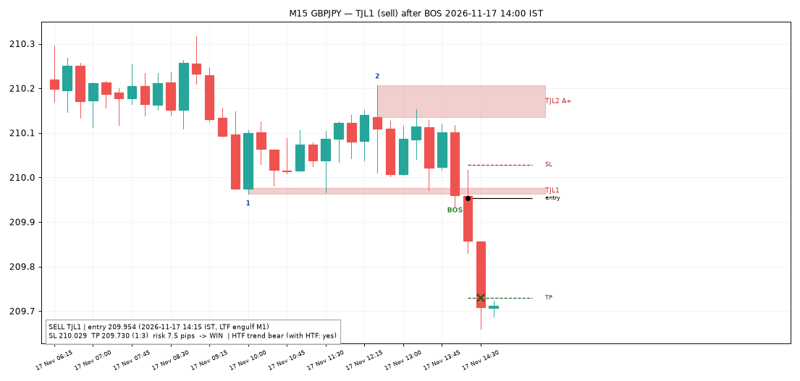

### M15 EURJPY — TJL1 sell — LOSS
Setup 2026-11-17 09:45 IST · entry 175.192 at 2026-11-17 10:00 · SL 175.268 · TP 174.963 · risk 7.6 pips · HTF trend bear

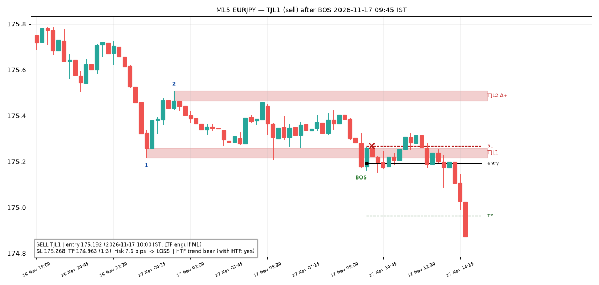

### M15 USDCAD — TJL2 A+ buy — WIN
Setup 2026-11-16 21:15 IST · entry 1.42926 at 2026-11-16 22:45 · SL 1.42892 · TP 1.43028 · risk 3.4 pips · HTF trend bull

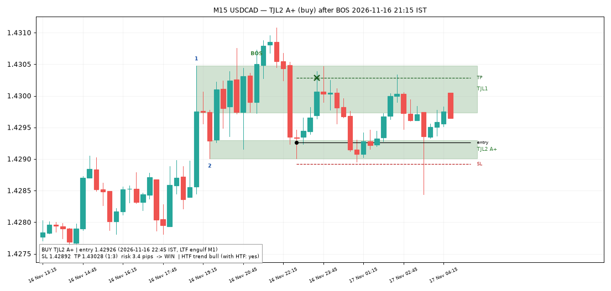

### M15 USDCHF — TJL2 A+ buy — LOSS
Setup 2026-11-16 15:00 IST · entry 0.83912 at 2026-11-16 18:00 · SL 0.83854 · TP 0.84086 · risk 5.8 pips · HTF trend bull

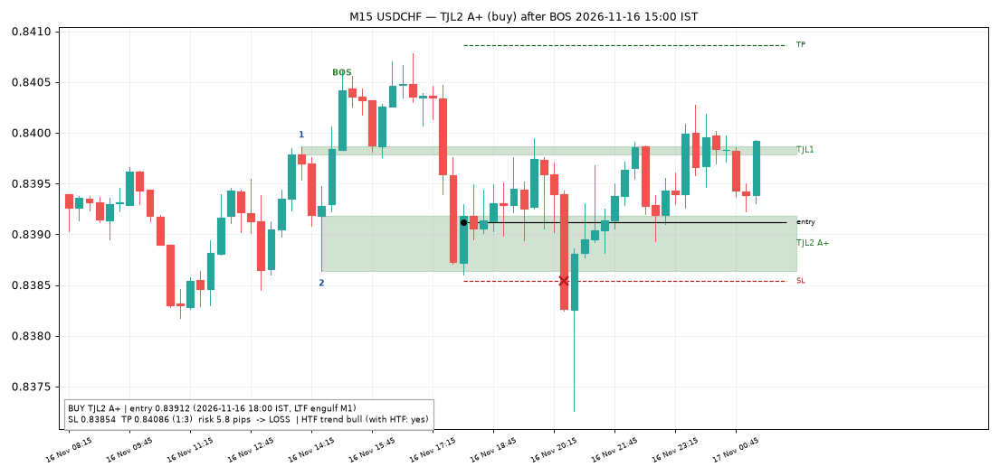

### H1 USDCAD — TJL1 buy — WIN
Setup 2026-11-16 05:30 IST · entry 1.42744 at 2026-11-16 07:30 · SL 1.42635 · TP 1.43070 · risk 10.9 pips · HTF trend bull

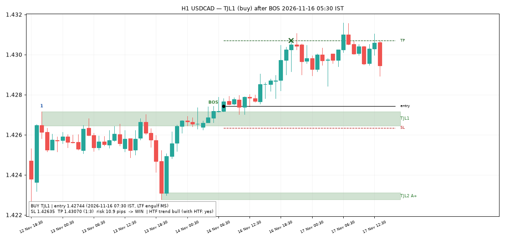

### H1 GBPJPY — TJL1 sell — LOSS
Setup 2026-11-16 20:30 IST · entry 210.434 at 2026-11-16 21:30 · SL 210.581 · TP 209.992 · risk 14.7 pips · HTF trend bear

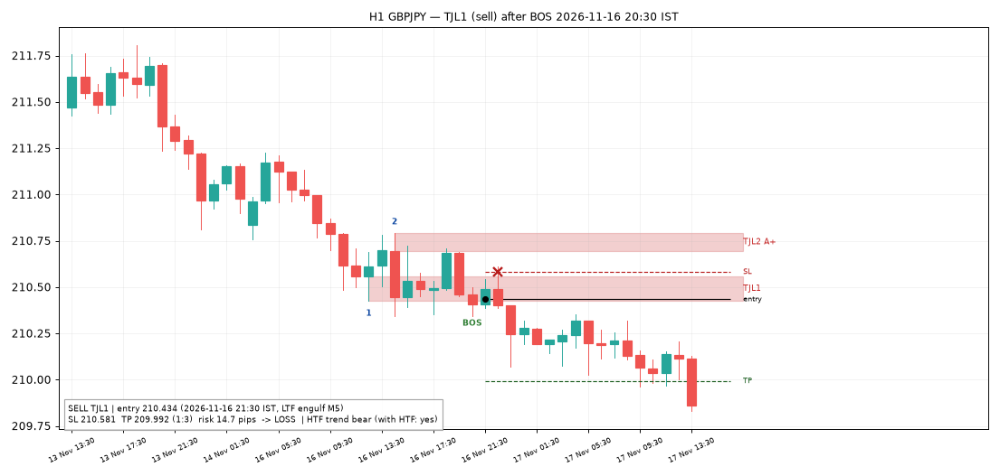

### H1 USDCAD — TJL2 A+ buy — WIN
Setup 2026-11-13 15:30 IST · entry 1.42393 at 2026-11-13 20:30 · SL 1.42230 · TP 1.42882 · risk 16.3 pips · HTF trend bull

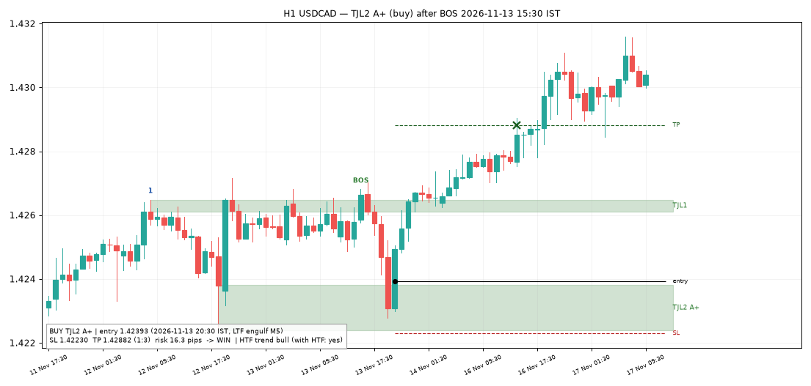

### H1 GBPJPY — TJL2 A+ sell — LOSS
Setup 2026-11-06 19:30 IST · entry 212.385 at 2026-11-10 05:30 · SL 212.497 · TP 212.050 · risk 11.2 pips · HTF trend bear

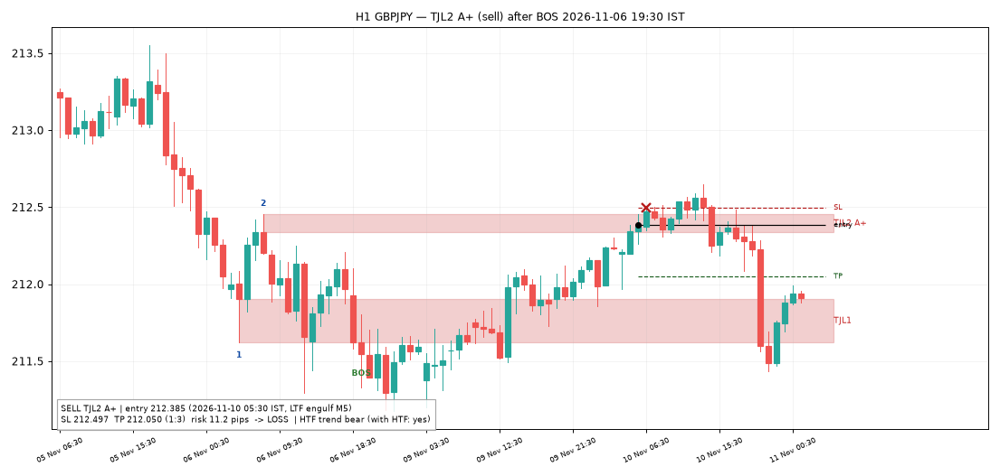

### H4 USDCAD — TJL1 buy — WIN
Setup 2026-11-13 21:30 IST · entry 1.42673 at 2026-11-14 01:30 · SL 1.42567 · TP 1.42990 · risk 10.6 pips · HTF trend bull

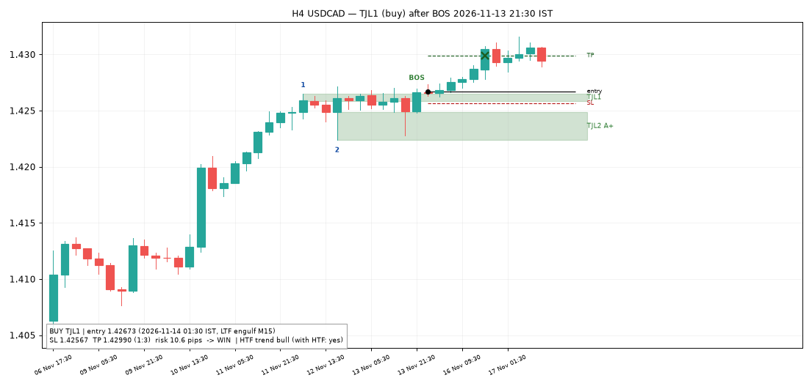

### H4 NZDUSD — TJL1 sell — LOSS
Setup 2026-11-06 05:30 IST · entry 0.56094 at 2026-11-09 13:30 · SL 0.56175 · TP 0.55851 · risk 8.1 pips · HTF trend bear

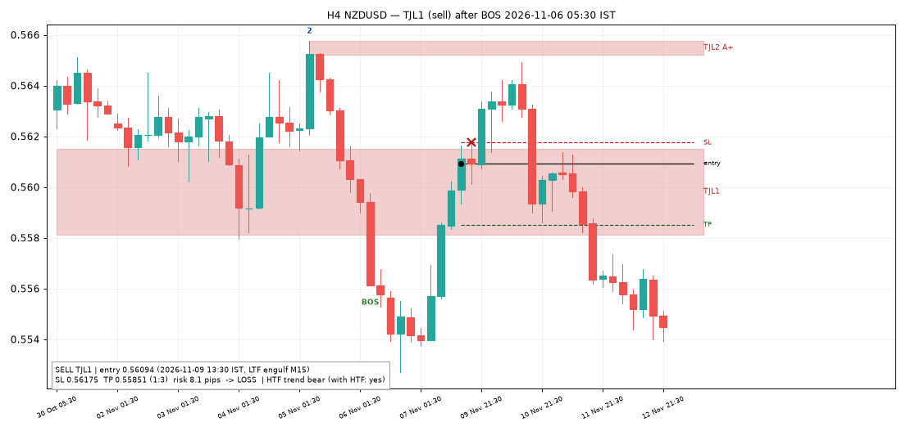

### H4 USDCAD — TJL2 A+ sell — WIN
Setup 2026-10-22 09:30 IST · entry 1.40649 at 2026-10-28 09:30 · SL 1.40836 · TP 1.40087 · risk 18.7 pips · HTF trend bull

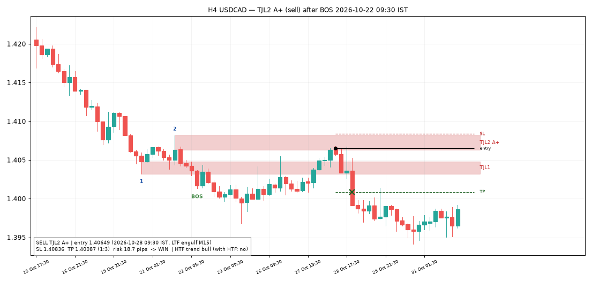

### H4 AUDUSD — TJL2 A+ buy — LOSS
Setup 2026-10-23 21:30 IST · entry 0.69994 at 2026-11-03 01:30 · SL 0.69918 · TP 0.70221 · risk 7.6 pips · HTF trend bear

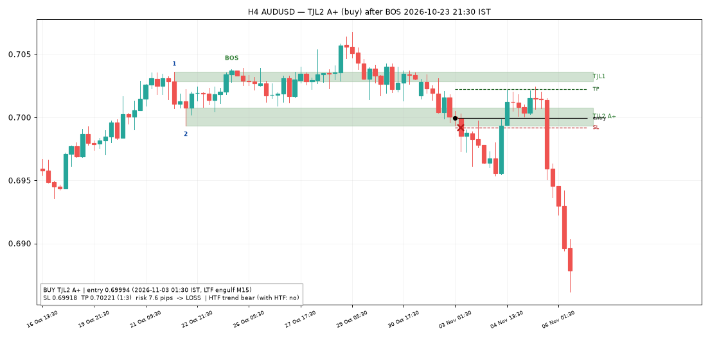

### D1 AUDUSD — TJL1 buy — WIN
Setup 2026-05-06 05:30 IST · entry 0.72080 at 2026-05-07 05:30 · SL 0.71916 · TP 0.72572 · risk 16.4 pips · HTF trend n/a

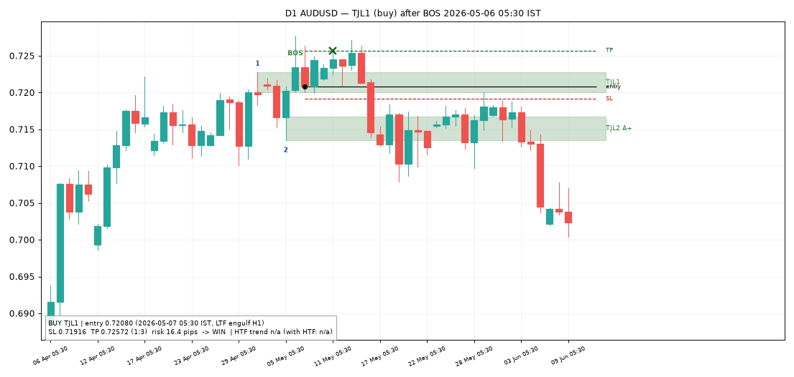

### D1 AUDUSD — TJL1 sell — LOSS
Setup 2026-11-06 05:30 IST · entry 0.68876 at 2026-11-09 05:30 · SL 0.69068 · TP 0.68300 · risk 19.2 pips · HTF trend n/a

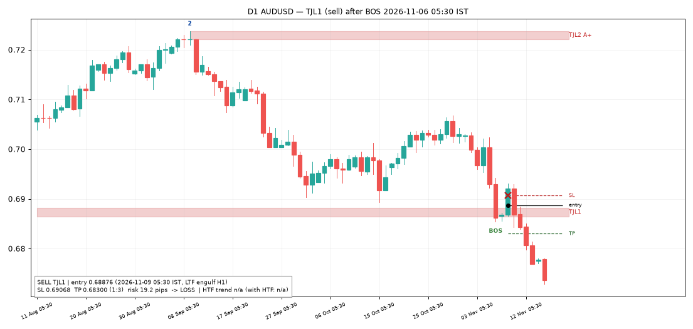

### D1 EURJPY — TJL2 A+ sell — WIN
Setup 2026-10-22 05:30 IST · entry 178.284 at 2026-11-04 05:30 · SL 178.581 · TP 177.392 · risk 29.7 pips · HTF trend n/a

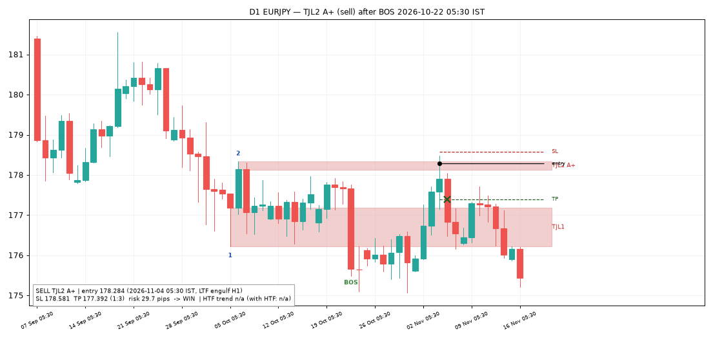

### D1 AUDUSD — TJL2 A+ buy — LOSS
Setup 2026-05-06 05:30 IST · entry 0.71720 at 2026-05-15 05:30 · SL 0.71298 · TP 0.72985 · risk 42.2 pips · HTF trend n/a

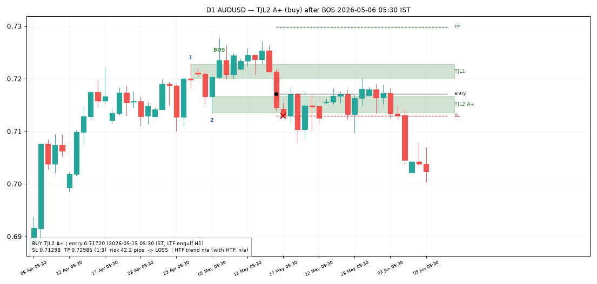

Full trade log: `trades.csv` (one row per setup × entry method).
