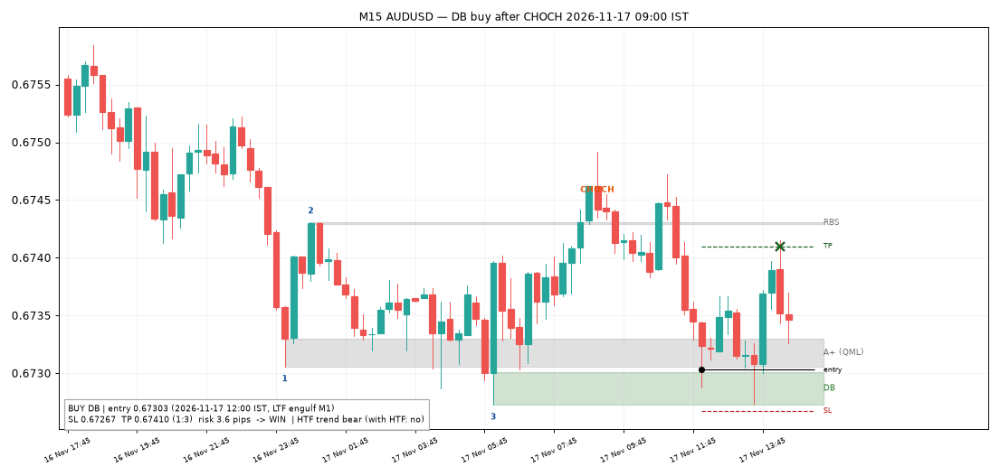
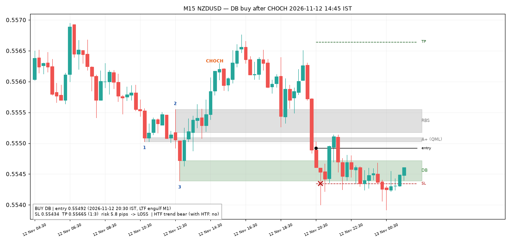
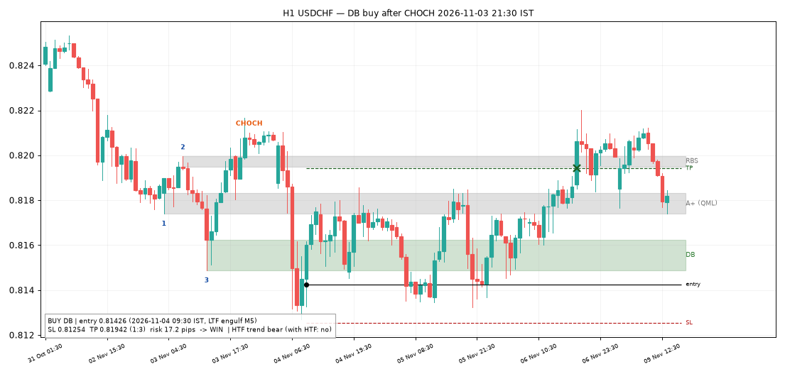
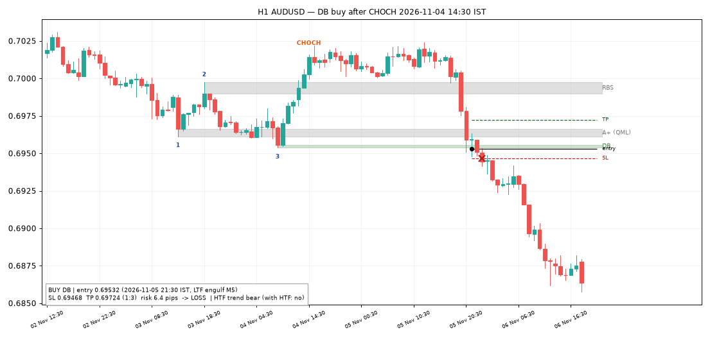
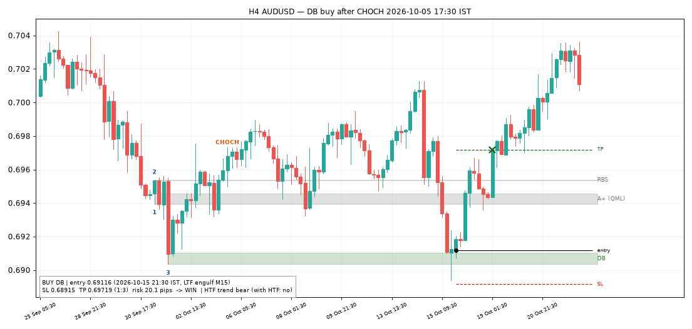
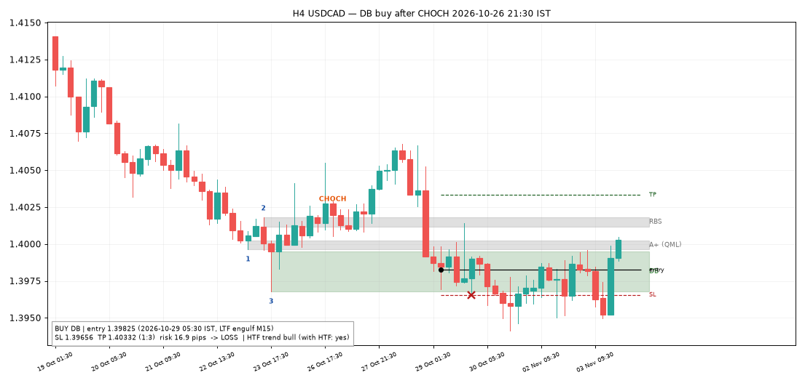
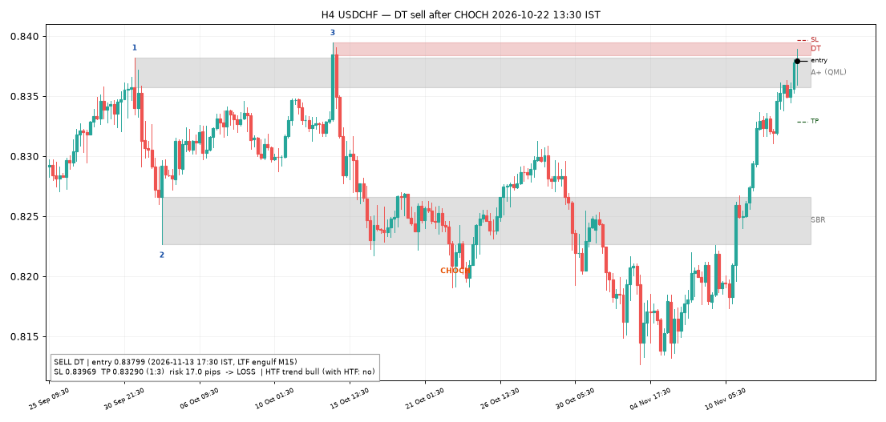
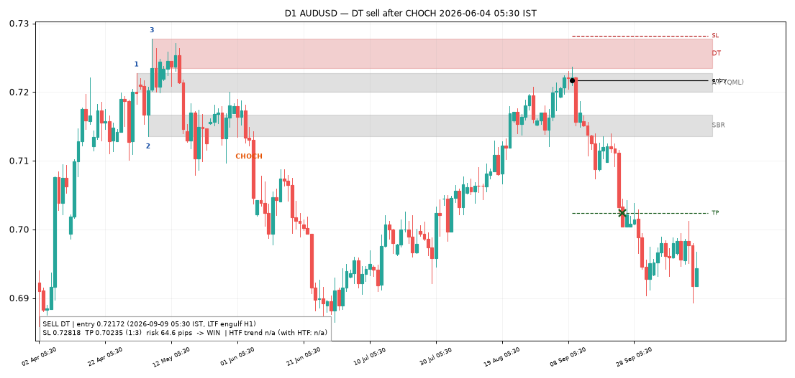
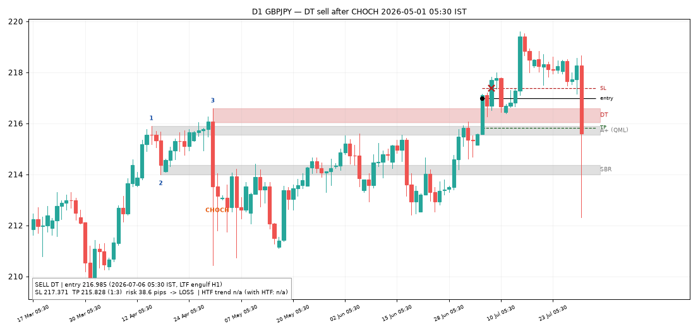
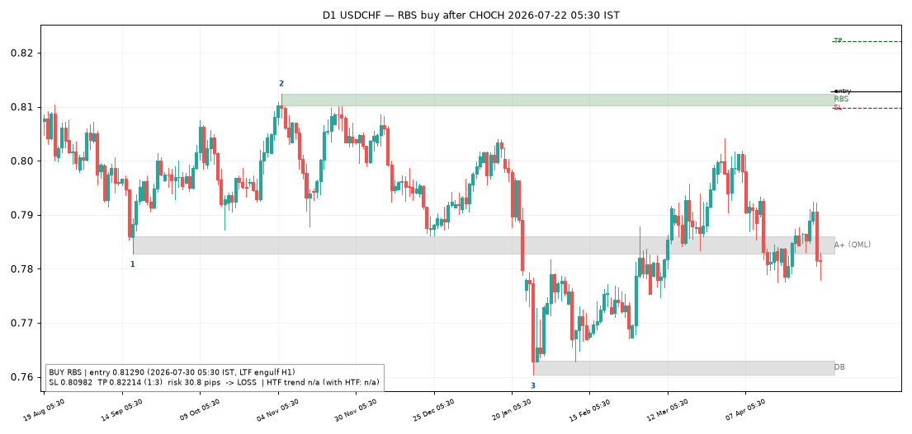

# 03 — Change of Character (CHOCH)

## Rules practised
- **Bearish CHOCH**: 2 consecutive candles CLOSE below the last support (level 2); first must be red, second any colour. **Bullish** = mirror above last resistance.
- Then trade the opposite way from 3 levels: **SBR/RBS** (level 2), **A+ / QML** (level 1, best: smallest stop), **DT/DB** (level 3).
- SBR/A+ setups are cancelled if price closes beyond DT/DB first (that would be a Dual CHOCH).

## How it was tested
- Pairs: AUDUSD, USDCAD, NZDUSD, EURJPY, USDCHF, GBPJPY (none on your watchlist). Data: Dukascopy bid, times in IST.
- Each setup is traded two ways: **raw** = limit order at the zone edge, SL beyond the zone (+0.1 ATR); **confirmed** = wait for price to touch the zone, then the first engulfing candle on the lower timeframe (D1→H1, H4→M15, H1→M5, M15→M1), market entry at its close, SL beyond the touch swing (+0.1 ATR).
- Target 1:3 (course examples ~1:3). A setup is cancelled if a candle closes through its invalidation level before entry. `hit1R%`/`hit2R%` = how often price reached 1R/2R before the stop (useful if you'd book earlier).
- Break-even win rate at 1:3 is 25%.

## Results by timeframe
| tf | method | trades | wins | losses | win% | net_R | R/trade | hit1R% | hit2R% |
|---|---|---|---|---|---|---|---|---|---|
| D1 | confirmed | 8 | 3 | 5 | 37.5 | 4.0 | 0.5 | 66.7 | 33.3 |
| D1 | raw | 54 | 13 | 41 | 24.1 | -2.0 | -0.04 | 40.7 | 29.6 |
| H1 | confirmed | 89 | 24 | 65 | 27.0 | 7.0 | 0.08 | 54.4 | 37.8 |
| H1 | raw | 256 | 60 | 196 | 23.4 | -16.0 | -0.06 | 38.7 | 28.1 |
| H4 | confirmed | 28 | 6 | 22 | 21.4 | -4.0 | -0.14 | 50.0 | 25.0 |
| H4 | raw | 144 | 31 | 113 | 21.5 | -20.0 | -0.14 | 32.6 | 27.1 |
| M15 | confirmed | 361 | 80 | 281 | 22.2 | -41.0 | -0.11 | 51.5 | 31.9 |
| M15 | raw | 433 | 92 | 341 | 21.2 | -65.0 | -0.15 | 35.8 | 27.5 |

## Results by zone
| tf | setup | method | trades | wins | losses | win% | net_R | R/trade | hit1R% | hit2R% |
|---|---|---|---|---|---|---|---|---|---|---|
| D1 | A+ (QML) | confirmed | 2 | 0 | 2 | 0.0 | -2.0 | -1.0 | 100.0 | 0.0 |
| D1 | A+ (QML) | raw | 17 | 4 | 13 | 23.5 | -1.0 | -0.06 | 58.8 | 35.3 |
| D1 | DB | raw | 5 | 1 | 4 | 20.0 | -1.0 | -0.2 | 20.0 | 20.0 |
| D1 | DT | confirmed | 2 | 1 | 1 | 50.0 | 2.0 | 1.0 | 66.7 | 33.3 |
| D1 | DT | raw | 9 | 2 | 7 | 22.2 | -1.0 | -0.11 | 33.3 | 33.3 |
| D1 | RBS | confirmed | 1 | 0 | 1 | 0.0 | -1.0 | -1.0 | 0.0 | 0.0 |
| D1 | RBS | raw | 9 | 3 | 6 | 33.3 | 3.0 | 0.33 | 44.4 | 33.3 |
| D1 | SBR | confirmed | 3 | 2 | 1 | 66.7 | 5.0 | 1.67 | 66.7 | 66.7 |
| D1 | SBR | raw | 14 | 3 | 11 | 21.4 | -2.0 | -0.14 | 28.6 | 21.4 |
| H1 | A+ (QML) | confirmed | 27 | 5 | 22 | 18.5 | -7.0 | -0.26 | 48.1 | 29.6 |
| H1 | A+ (QML) | raw | 79 | 16 | 63 | 20.3 | -15.0 | -0.19 | 36.7 | 27.8 |
| H1 | DB | confirmed | 8 | 1 | 7 | 12.5 | -4.0 | -0.5 | 37.5 | 12.5 |
| H1 | DB | raw | 34 | 11 | 23 | 32.4 | 10.0 | 0.29 | 44.1 | 35.3 |
| H1 | DT | confirmed | 10 | 4 | 6 | 40.0 | 6.0 | 0.6 | 60.0 | 40.0 |
| H1 | DT | raw | 33 | 5 | 28 | 15.2 | -13.0 | -0.39 | 30.3 | 21.2 |
| H1 | RBS | confirmed | 22 | 6 | 16 | 27.3 | 2.0 | 0.09 | 47.8 | 39.1 |
| H1 | RBS | raw | 54 | 14 | 40 | 25.9 | 2.0 | 0.04 | 37.0 | 25.9 |
| H1 | SBR | confirmed | 22 | 8 | 14 | 36.4 | 10.0 | 0.45 | 72.7 | 54.5 |
| H1 | SBR | raw | 56 | 14 | 42 | 25.0 | 0.0 | 0.0 | 44.6 | 30.4 |
| H4 | A+ (QML) | confirmed | 7 | 0 | 7 | 0.0 | -7.0 | -1.0 | 42.9 | 14.3 |
| H4 | A+ (QML) | raw | 44 | 12 | 32 | 27.3 | 4.0 | 0.09 | 45.5 | 31.8 |
| H4 | DB | confirmed | 4 | 1 | 3 | 25.0 | 0.0 | 0.0 | 75.0 | 25.0 |
| H4 | DB | raw | 16 | 1 | 15 | 6.2 | -12.0 | -0.75 | 12.5 | 12.5 |
| H4 | DT | confirmed | 4 | 0 | 4 | 0.0 | -4.0 | -1.0 | 25.0 | 0.0 |
| H4 | DT | raw | 20 | 5 | 15 | 25.0 | 0.0 | 0.0 | 30.0 | 25.0 |
| H4 | RBS | confirmed | 5 | 3 | 2 | 60.0 | 7.0 | 1.4 | 80.0 | 60.0 |
| H4 | RBS | raw | 26 | 5 | 21 | 19.2 | -6.0 | -0.23 | 26.9 | 26.9 |
| H4 | SBR | confirmed | 8 | 2 | 6 | 25.0 | 0.0 | 0.0 | 37.5 | 25.0 |
| H4 | SBR | raw | 38 | 8 | 30 | 21.1 | -6.0 | -0.16 | 31.6 | 28.9 |
| M15 | A+ (QML) | confirmed | 102 | 25 | 77 | 24.5 | -2.0 | -0.02 | 52.4 | 33.0 |
| M15 | A+ (QML) | raw | 136 | 29 | 107 | 21.3 | -20.0 | -0.15 | 33.1 | 27.9 |
| M15 | DB | confirmed | 44 | 12 | 32 | 27.3 | 4.0 | 0.09 | 55.6 | 35.6 |
| M15 | DB | raw | 56 | 16 | 40 | 28.6 | 8.0 | 0.14 | 40.4 | 28.1 |
| M15 | DT | confirmed | 47 | 9 | 38 | 19.1 | -11.0 | -0.23 | 54.2 | 27.1 |
| M15 | DT | raw | 54 | 10 | 44 | 18.5 | -14.0 | -0.26 | 37.0 | 29.6 |
| M15 | RBS | confirmed | 87 | 16 | 71 | 18.4 | -23.0 | -0.26 | 49.4 | 28.1 |
| M15 | RBS | raw | 98 | 13 | 85 | 13.3 | -46.0 | -0.47 | 28.3 | 19.2 |
| M15 | SBR | confirmed | 81 | 18 | 63 | 22.2 | -9.0 | -0.11 | 48.8 | 35.4 |
| M15 | SBR | raw | 89 | 24 | 65 | 27.0 | 7.0 | 0.08 | 44.4 | 34.4 |

## With vs against the higher-timeframe trend
| tf | with_htf | method | trades | wins | losses | win% | net_R | R/trade | hit1R% | hit2R% |
|---|---|---|---|---|---|---|---|---|---|---|
| D1 | n/a | confirmed | 8 | 3 | 5 | 37.5 | 4.0 | 0.5 | 66.7 | 33.3 |
| D1 | n/a | raw | 54 | 13 | 41 | 24.1 | -2.0 | -0.04 | 40.7 | 29.6 |
| H1 | no | confirmed | 68 | 18 | 50 | 26.5 | 4.0 | 0.06 | 58.0 | 36.2 |
| H1 | no | raw | 173 | 33 | 140 | 19.1 | -41.0 | -0.24 | 37.6 | 24.3 |
| H1 | yes | confirmed | 21 | 6 | 15 | 28.6 | 3.0 | 0.14 | 42.9 | 42.9 |
| H1 | yes | raw | 83 | 27 | 56 | 32.5 | 25.0 | 0.3 | 41.0 | 36.1 |
| H4 | no | confirmed | 15 | 2 | 13 | 13.3 | -7.0 | -0.47 | 33.3 | 13.3 |
| H4 | no | raw | 90 | 20 | 70 | 22.2 | -10.0 | -0.11 | 34.4 | 28.9 |
| H4 | yes | confirmed | 13 | 4 | 9 | 30.8 | 3.0 | 0.23 | 69.2 | 38.5 |
| H4 | yes | raw | 54 | 11 | 43 | 20.4 | -10.0 | -0.19 | 29.6 | 24.1 |
| M15 | no | confirmed | 243 | 47 | 196 | 19.3 | -55.0 | -0.23 | 52.6 | 30.0 |
| M15 | no | raw | 289 | 63 | 226 | 21.8 | -37.0 | -0.13 | 34.1 | 27.6 |
| M15 | yes | confirmed | 118 | 33 | 85 | 28.0 | 14.0 | 0.12 | 49.2 | 35.8 |
| M15 | yes | raw | 144 | 29 | 115 | 20.1 | -28.0 | -0.19 | 39.0 | 27.4 |

## Example charts (confirmed entries; most recent wins and losses per timeframe)
### M15 AUDUSD — A+ (QML) buy — WIN
Setup 2026-11-17 09:00 IST · entry 0.67303 at 2026-11-17 12:00 · SL 0.67282 · TP 0.67365 · risk 2.1 pips · HTF trend bear

_win.png)

### M15 USDCHF — A+ (QML) sell — LOSS
Setup 2026-11-16 03:30 IST · entry 0.83935 at 2026-11-16 06:00 · SL 0.83957 · TP 0.83869 · risk 2.2 pips · HTF trend bull

_loss.png)

### M15 AUDUSD — DB buy — WIN
Setup 2026-11-17 09:00 IST · entry 0.67303 at 2026-11-17 12:00 · SL 0.67267 · TP 0.67410 · risk 3.6 pips · HTF trend bear

### M15 NZDUSD — DB buy — LOSS
Setup 2026-11-12 14:45 IST · entry 0.55492 at 2026-11-12 20:30 · SL 0.55434 · TP 0.55665 · risk 5.8 pips · HTF trend bear

### H1 AUDUSD — A+ (QML) buy — WIN
Setup 2026-10-09 07:30 IST · entry 0.69509 at 2026-10-13 05:30 · SL 0.69414 · TP 0.69794 · risk 9.5 pips · HTF trend bull

_win.png)

### H1 GBPJPY — A+ (QML) buy — LOSS
Setup 2026-11-10 11:30 IST · entry 211.636 at 2026-11-10 21:30 · SL 211.550 · TP 211.893 · risk 8.6 pips · HTF trend bear

_loss.png)

### H1 USDCHF — DB buy — WIN
Setup 2026-11-03 21:30 IST · entry 0.81426 at 2026-11-04 09:30 · SL 0.81254 · TP 0.81942 · risk 17.2 pips · HTF trend bear

### H1 AUDUSD — DB buy — LOSS
Setup 2026-11-04 14:30 IST · entry 0.69532 at 2026-11-05 21:30 · SL 0.69468 · TP 0.69724 · risk 6.4 pips · HTF trend bear

### H4 USDCAD — A+ (QML) buy — LOSS
Setup 2026-10-26 21:30 IST · entry 1.39825 at 2026-10-29 05:30 · SL 1.39673 · TP 1.40281 · risk 15.2 pips · HTF trend bull

_loss.png)

### H4 AUDUSD — DB buy — WIN
Setup 2026-10-05 17:30 IST · entry 0.69116 at 2026-10-15 21:30 · SL 0.68915 · TP 0.69719 · risk 20.1 pips · HTF trend bear

### H4 USDCAD — DB buy — LOSS
Setup 2026-10-26 21:30 IST · entry 1.39825 at 2026-10-29 05:30 · SL 1.39656 · TP 1.40332 · risk 16.9 pips · HTF trend bull

### H4 USDCHF — DT sell — LOSS
Setup 2026-10-22 13:30 IST · entry 0.83799 at 2026-11-13 17:30 · SL 0.83969 · TP 0.83290 · risk 17.0 pips · HTF trend bull

### D1 USDCHF — A+ (QML) sell — LOSS
Setup 2026-11-05 05:30 IST · entry 0.83300 at 2026-11-11 05:30 · SL 0.83452 · TP 0.82845 · risk 15.2 pips · HTF trend n/a

_loss.png)

### D1 AUDUSD — DT sell — WIN
Setup 2026-06-04 05:30 IST · entry 0.72172 at 2026-09-09 05:30 · SL 0.72818 · TP 0.70235 · risk 64.6 pips · HTF trend n/a

### D1 GBPJPY — DT sell — LOSS
Setup 2026-05-01 05:30 IST · entry 216.985 at 2026-07-06 05:30 · SL 217.371 · TP 215.828 · risk 38.6 pips · HTF trend n/a

### D1 USDCHF — RBS buy — LOSS
Setup 2026-07-22 05:30 IST · entry 0.81290 at 2026-07-30 05:30 · SL 0.80982 · TP 0.82214 · risk 30.8 pips · HTF trend n/a

Full trade log: `trades.csv` (one row per setup × entry method).
