# 04 — Dual CHOCH

## Rules practised
- After a normal CHOCH, price reverses from an exact zone and CLOSES back beyond level 3 (double top / double bottom) with 2 candles → the original trend resumes.
- Mark the reversal extreme as the **new 4th level**; trade the resumed trend from level 4 and from the broken DT/DB.

## How it was tested
- Pairs: AUDUSD, USDCAD, NZDUSD, EURJPY, USDCHF, GBPJPY (none on your watchlist). Data: Dukascopy bid, times in IST.
- Each setup is traded two ways: **raw** = limit order at the zone edge, SL beyond the zone (+0.1 ATR); **confirmed** = wait for price to touch the zone, then the first engulfing candle on the lower timeframe (D1→H1, H4→M15, H1→M5, M15→M1), market entry at its close, SL beyond the touch swing (+0.1 ATR).
- Target 1:3 (course examples ~1:3). A setup is cancelled if a candle closes through its invalidation level before entry. `hit1R%`/`hit2R%` = how often price reached 1R/2R before the stop (useful if you'd book earlier).
- Break-even win rate at 1:3 is 25%.

## Results by timeframe
| tf | method | trades | wins | losses | win% | net_R | R/trade | hit1R% | hit2R% |
|---|---|---|---|---|---|---|---|---|---|
| D1 | confirmed | 7 | 1 | 6 | 14.3 | -3.0 | -0.43 | 71.4 | 42.9 |
| D1 | raw | 25 | 3 | 22 | 12.0 | -13.0 | -0.52 | 32.0 | 16.0 |
| H1 | confirmed | 10 | 3 | 7 | 30.0 | 2.0 | 0.2 | 63.6 | 45.5 |
| H1 | raw | 39 | 8 | 31 | 20.5 | -7.0 | -0.18 | 41.5 | 26.8 |
| H4 | confirmed | 5 | 0 | 5 | 0.0 | -5.0 | -1.0 | 60.0 | 20.0 |
| H4 | raw | 24 | 4 | 20 | 16.7 | -8.0 | -0.33 | 33.3 | 25.0 |
| M15 | confirmed | 77 | 19 | 58 | 24.7 | -1.0 | -0.01 | 49.4 | 31.6 |
| M15 | raw | 91 | 21 | 70 | 23.1 | -7.0 | -0.08 | 34.4 | 28.0 |

## Results by zone
| tf | setup | method | trades | wins | losses | win% | net_R | R/trade | hit1R% | hit2R% |
|---|---|---|---|---|---|---|---|---|---|---|
| D1 | broken DB | confirmed | 2 | 1 | 1 | 50.0 | 2.0 | 1.0 | 100.0 | 50.0 |
| D1 | broken DB | raw | 6 | 0 | 6 | 0.0 | -6.0 | -1.0 | 33.3 | 16.7 |
| D1 | broken DT | confirmed | 2 | 0 | 2 | 0.0 | -2.0 | -1.0 | 100.0 | 50.0 |
| D1 | broken DT | raw | 10 | 2 | 8 | 20.0 | -2.0 | -0.2 | 40.0 | 20.0 |
| D1 | level 4 | confirmed | 3 | 0 | 3 | 0.0 | -3.0 | -1.0 | 33.3 | 33.3 |
| D1 | level 4 | raw | 9 | 1 | 8 | 11.1 | -5.0 | -0.56 | 22.2 | 11.1 |
| H1 | broken DB | confirmed | 4 | 1 | 3 | 25.0 | 0.0 | 0.0 | 60.0 | 40.0 |
| H1 | broken DB | raw | 13 | 2 | 11 | 15.4 | -5.0 | -0.38 | 42.9 | 21.4 |
| H1 | broken DT | confirmed | 4 | 1 | 3 | 25.0 | 0.0 | 0.0 | 50.0 | 50.0 |
| H1 | broken DT | raw | 15 | 3 | 12 | 20.0 | -3.0 | -0.2 | 40.0 | 26.7 |
| H1 | level 4 | confirmed | 2 | 1 | 1 | 50.0 | 2.0 | 1.0 | 100.0 | 50.0 |
| H1 | level 4 | raw | 11 | 3 | 8 | 27.3 | 1.0 | 0.09 | 41.7 | 33.3 |
| H4 | broken DB | confirmed | 2 | 0 | 2 | 0.0 | -2.0 | -1.0 | 100.0 | 50.0 |
| H4 | broken DB | raw | 7 | 1 | 6 | 14.3 | -3.0 | -0.43 | 28.6 | 14.3 |
| H4 | broken DT | confirmed | 1 | 0 | 1 | 0.0 | -1.0 | -1.0 | 0.0 | 0.0 |
| H4 | broken DT | raw | 9 | 2 | 7 | 22.2 | -1.0 | -0.11 | 33.3 | 33.3 |
| H4 | level 4 | confirmed | 2 | 0 | 2 | 0.0 | -2.0 | -1.0 | 50.0 | 0.0 |
| H4 | level 4 | raw | 8 | 1 | 7 | 12.5 | -4.0 | -0.5 | 37.5 | 25.0 |
| M15 | broken DB | confirmed | 27 | 7 | 20 | 25.9 | 1.0 | 0.04 | 46.4 | 32.1 |
| M15 | broken DB | raw | 30 | 5 | 25 | 16.7 | -10.0 | -0.33 | 32.3 | 19.4 |
| M15 | broken DT | confirmed | 26 | 5 | 21 | 19.2 | -6.0 | -0.23 | 42.3 | 23.1 |
| M15 | broken DT | raw | 32 | 8 | 24 | 25.0 | 0.0 | 0.0 | 31.2 | 28.1 |
| M15 | level 4 | confirmed | 24 | 7 | 17 | 29.2 | 4.0 | 0.17 | 60.0 | 40.0 |
| M15 | level 4 | raw | 29 | 8 | 21 | 27.6 | 3.0 | 0.1 | 40.0 | 36.7 |

## With vs against the higher-timeframe trend
| tf | with_htf | method | trades | wins | losses | win% | net_R | R/trade | hit1R% | hit2R% |
|---|---|---|---|---|---|---|---|---|---|---|
| D1 | n/a | confirmed | 7 | 1 | 6 | 14.3 | -3.0 | -0.43 | 71.4 | 42.9 |
| D1 | n/a | raw | 25 | 3 | 22 | 12.0 | -13.0 | -0.52 | 32.0 | 16.0 |
| H1 | no | confirmed | 2 | 1 | 1 | 50.0 | 2.0 | 1.0 | 100.0 | 100.0 |
| H1 | no | raw | 12 | 3 | 9 | 25.0 | 0.0 | 0.0 | 53.8 | 46.2 |
| H1 | yes | confirmed | 8 | 2 | 6 | 25.0 | 0.0 | 0.0 | 55.6 | 33.3 |
| H1 | yes | raw | 27 | 5 | 22 | 18.5 | -7.0 | -0.26 | 35.7 | 17.9 |
| H4 | no | confirmed | 5 | 0 | 5 | 0.0 | -5.0 | -1.0 | 60.0 | 20.0 |
| H4 | no | raw | 13 | 1 | 12 | 7.7 | -9.0 | -0.69 | 23.1 | 7.7 |
| H4 | yes | raw | 11 | 3 | 8 | 27.3 | 1.0 | 0.09 | 45.5 | 45.5 |
| M15 | no | confirmed | 34 | 6 | 28 | 17.6 | -10.0 | -0.29 | 47.1 | 26.5 |
| M15 | no | raw | 38 | 6 | 32 | 15.8 | -14.0 | -0.37 | 26.3 | 18.4 |
| M15 | yes | confirmed | 43 | 13 | 30 | 30.2 | 9.0 | 0.21 | 51.1 | 35.6 |
| M15 | yes | raw | 53 | 15 | 38 | 28.3 | 7.0 | 0.13 | 40.0 | 34.5 |

## How often a CHOCH failed into a Dual CHOCH
| tf | choch | dual | dual% of CHOCH |
|---|---|---|---|
| D1 | 23 | 16 | 69.6 |
| H1 | 124 | 37 | 29.8 |
| H4 | 75 | 19 | 25.3 |
| M15 | 218 | 73 | 33.5 |

## Example charts (confirmed entries; most recent wins and losses per timeframe)
### M15 AUDUSD — broken DB sell — WIN
Setup 2026-11-12 11:00 IST · entry 0.68353 at 2026-11-12 11:30 · SL 0.68379 · TP 0.68276 · risk 2.6 pips · HTF trend bear

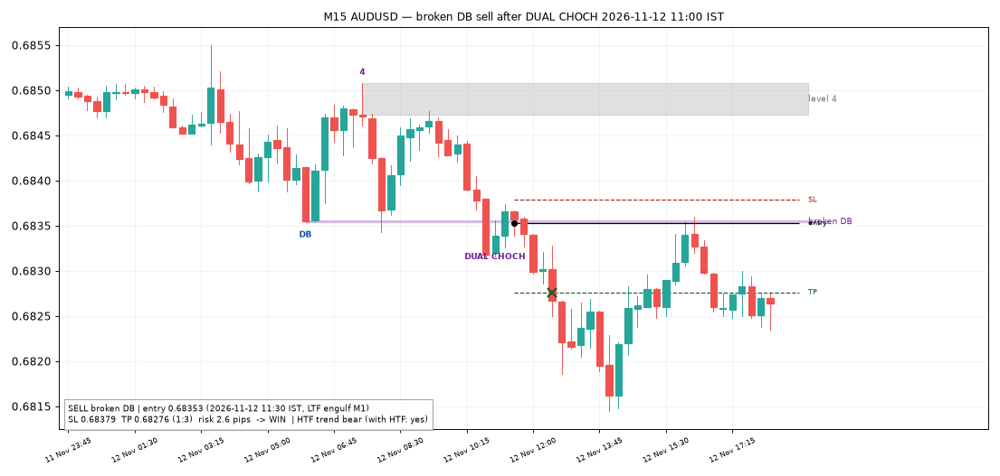

### M15 NZDUSD — broken DB sell — LOSS
Setup 2026-11-13 00:15 IST · entry 0.55434 at 2026-11-13 01:00 · SL 0.55476 · TP 0.55307 · risk 4.2 pips · HTF trend bear

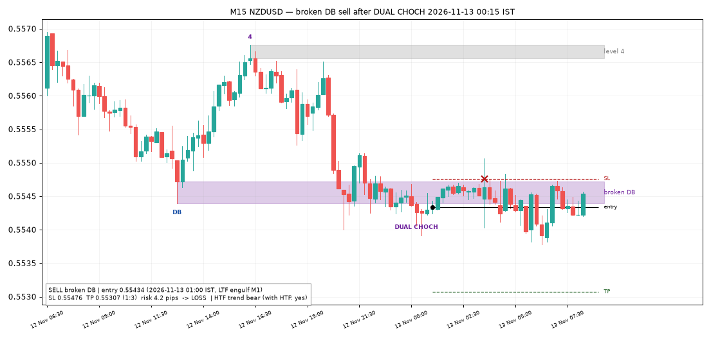

### M15 EURJPY — broken DT buy — WIN
Setup 2026-11-02 13:15 IST · entry 176.602 at 2026-11-02 13:30 · SL 176.465 · TP 177.012 · risk 13.7 pips · HTF trend bear

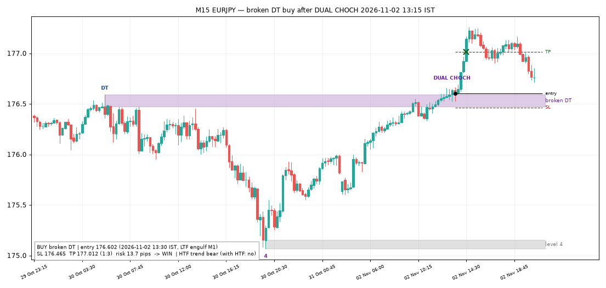

### M15 USDCHF — broken DT buy — LOSS
Setup 2026-11-16 14:00 IST · entry 0.83943 at 2026-11-16 14:30 · SL 0.83859 · TP 0.84195 · risk 8.4 pips · HTF trend bull

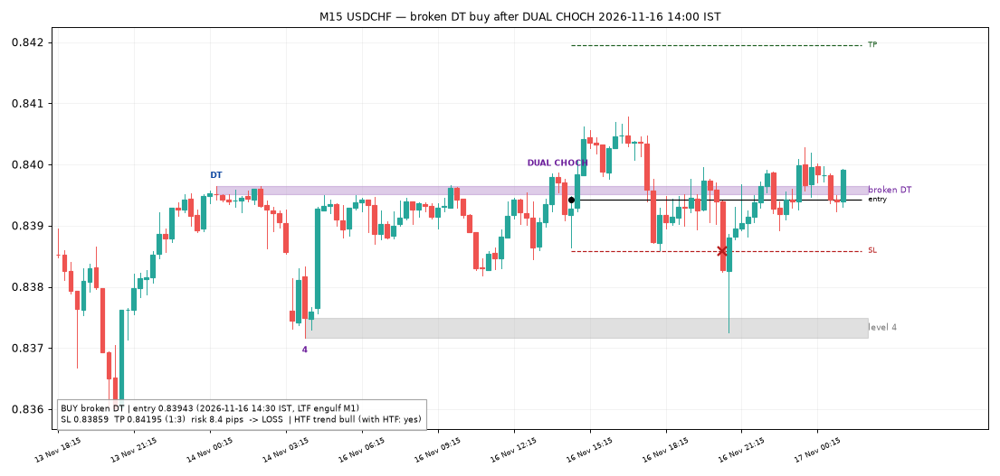

### H1 GBPJPY — broken DB sell — WIN
Setup 2026-11-14 00:30 IST · entry 211.095 at 2026-11-16 04:30 · SL 211.328 · TP 210.396 · risk 23.3 pips · HTF trend bear

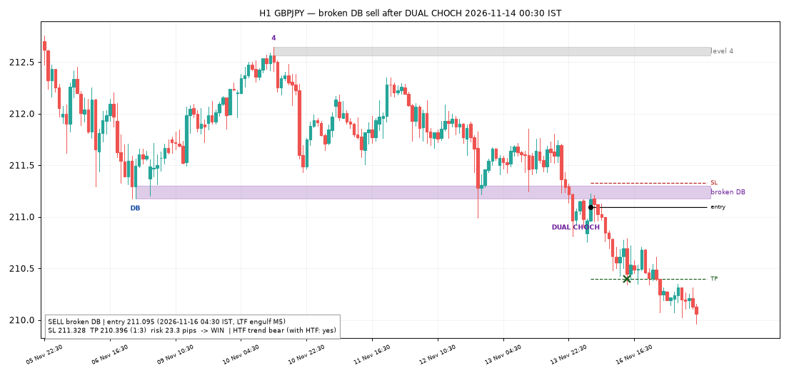

### H1 USDCHF — broken DB sell — LOSS
Setup 2026-11-04 08:30 IST · entry 0.81660 at 2026-11-04 10:30 · SL 0.81714 · TP 0.81498 · risk 5.4 pips · HTF trend bear

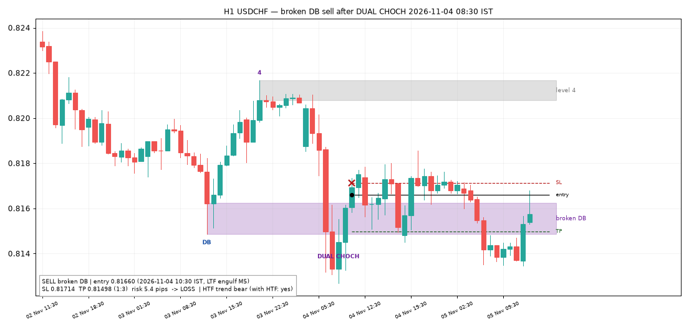

### H1 AUDUSD — broken DT buy — WIN
Setup 2026-10-21 07:30 IST · entry 0.70144 at 2026-10-21 10:30 · SL 0.70081 · TP 0.70332 · risk 6.3 pips · HTF trend bear

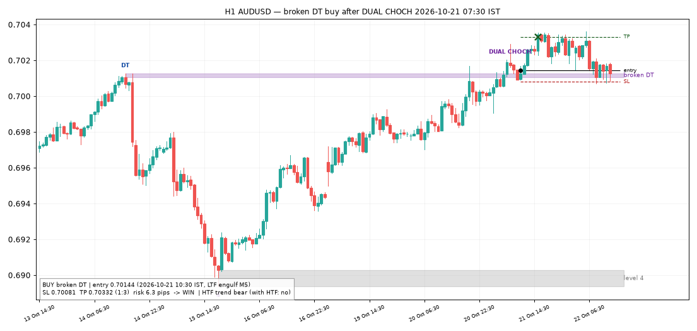

### H1 AUDUSD — broken DT buy — LOSS
Setup 2026-10-28 06:30 IST · entry 0.70370 at 2026-10-28 07:30 · SL 0.70261 · TP 0.70698 · risk 10.9 pips · HTF trend bull

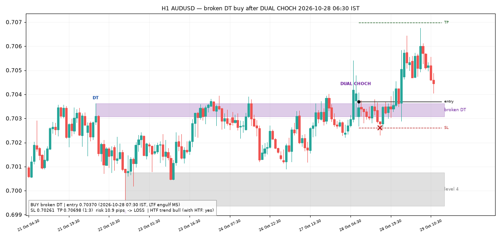

### H4 USDCAD — broken DB sell — LOSS
Setup 2026-10-30 13:30 IST · entry 1.39839 at 2026-11-02 09:30 · SL 1.39977 · TP 1.39424 · risk 13.8 pips · HTF trend bull

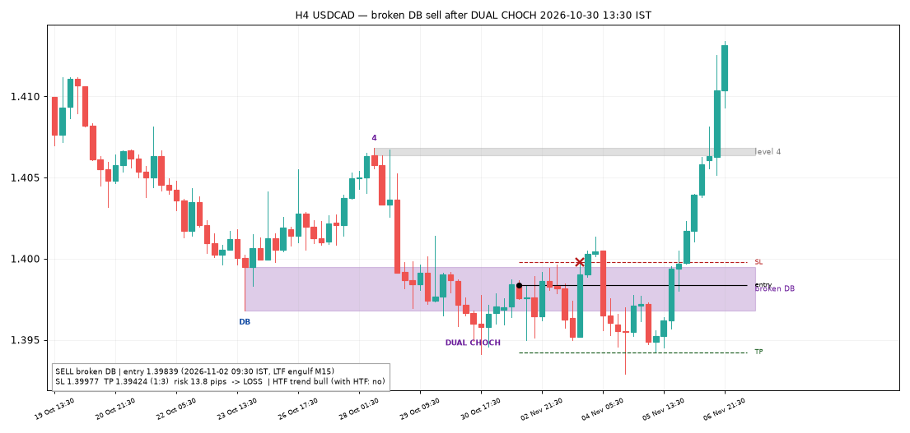

### H4 AUDUSD — broken DT buy — LOSS
Setup 2026-10-21 09:30 IST · entry 0.70161 at 2026-10-22 05:30 · SL 0.70060 · TP 0.70464 · risk 10.1 pips · HTF trend bear

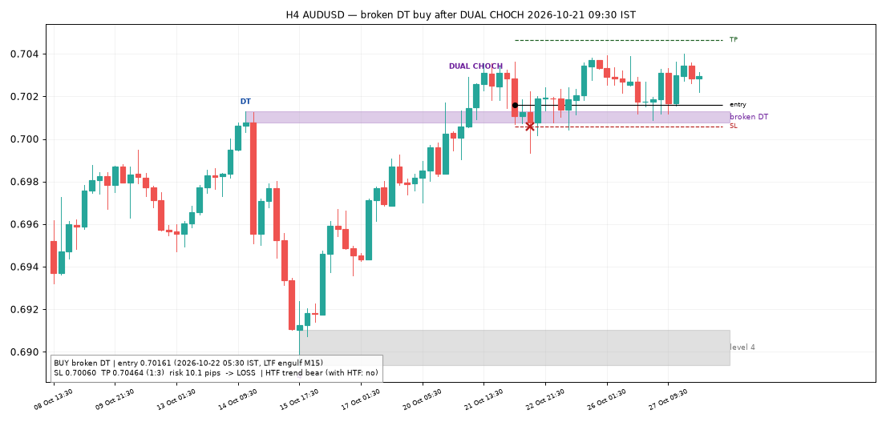

### H4 USDCAD — level 4 sell — LOSS
Setup 2026-10-30 13:30 IST · entry 1.40691 at 2026-11-06 13:30 · SL 1.40840 · TP 1.40245 · risk 14.9 pips · HTF trend bull

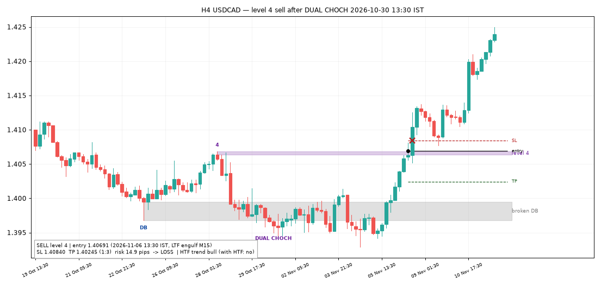

### H4 AUDUSD — level 4 buy — LOSS
Setup 2026-10-21 09:30 IST · entry 0.68739 at 2026-11-06 09:30 · SL 0.68600 · TP 0.69156 · risk 13.9 pips · HTF trend bear

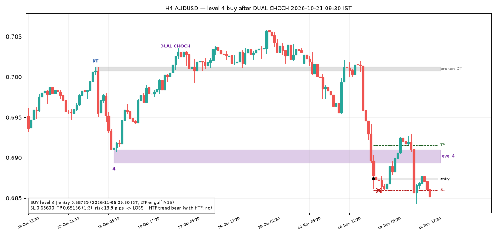

### D1 EURJPY — broken DB sell — WIN
Setup 2026-09-08 05:30 IST · entry 181.027 at 2026-09-18 05:30 · SL 181.667 · TP 179.106 · risk 64.0 pips · HTF trend n/a

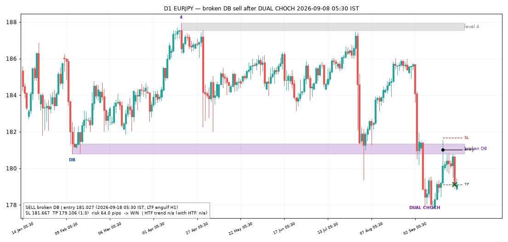

### D1 GBPJPY — broken DB sell — LOSS
Setup 2026-09-08 05:30 IST · entry 210.728 at 2026-09-18 05:30 · SL 213.697 · TP 201.822 · risk 296.9 pips · HTF trend n/a

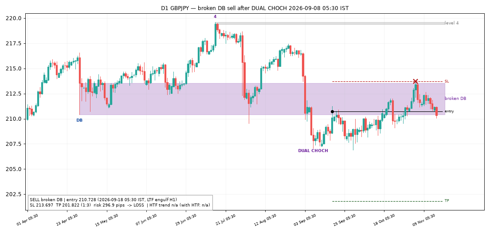

### D1 GBPJPY — broken DT buy — LOSS
Setup 2026-07-07 05:30 IST · entry 216.867 at 2026-07-14 05:30 · SL 215.950 · TP 219.618 · risk 91.7 pips · HTF trend n/a

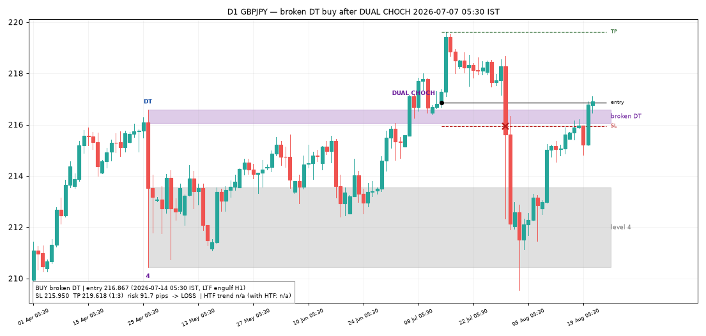

### D1 GBPJPY — level 4 buy — LOSS
Setup 2026-07-07 05:30 IST · entry 214.629 at 2026-07-30 05:30 · SL 210.332 · TP 227.521 · risk 429.7 pips · HTF trend n/a

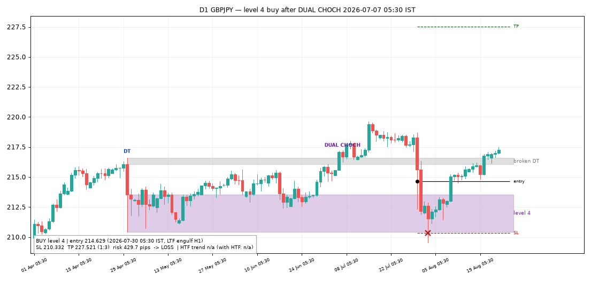

Full trade log: `trades.csv` (one row per setup × entry method).
