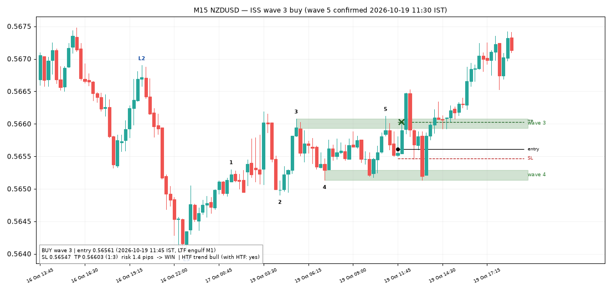
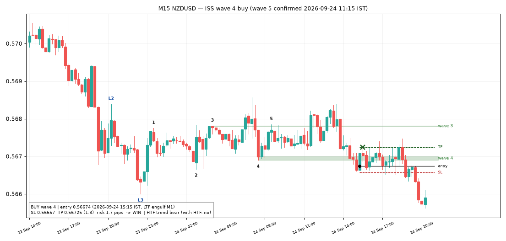
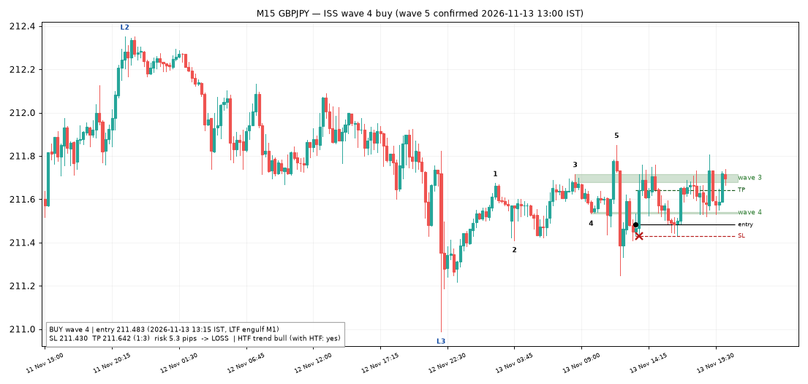
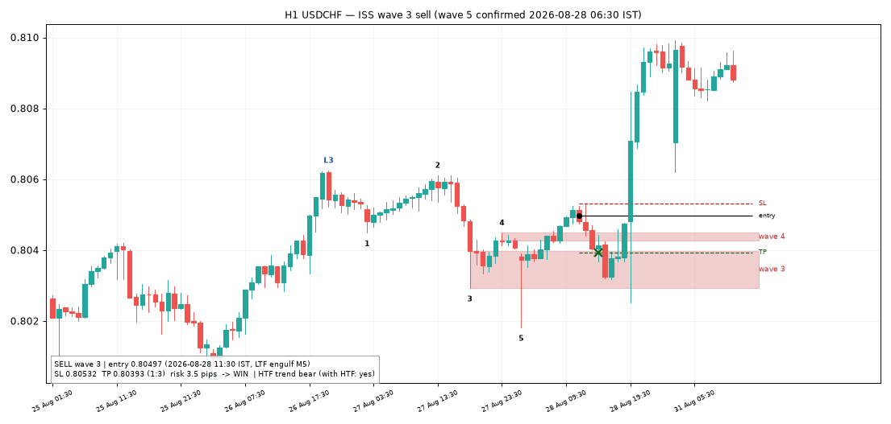
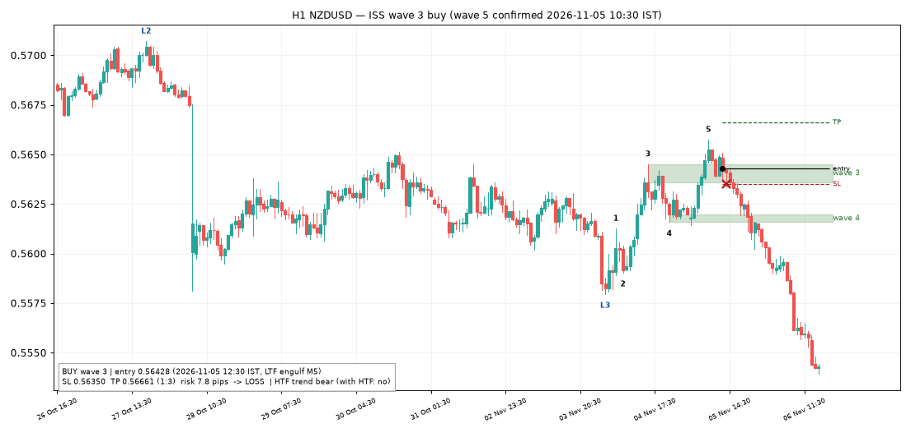
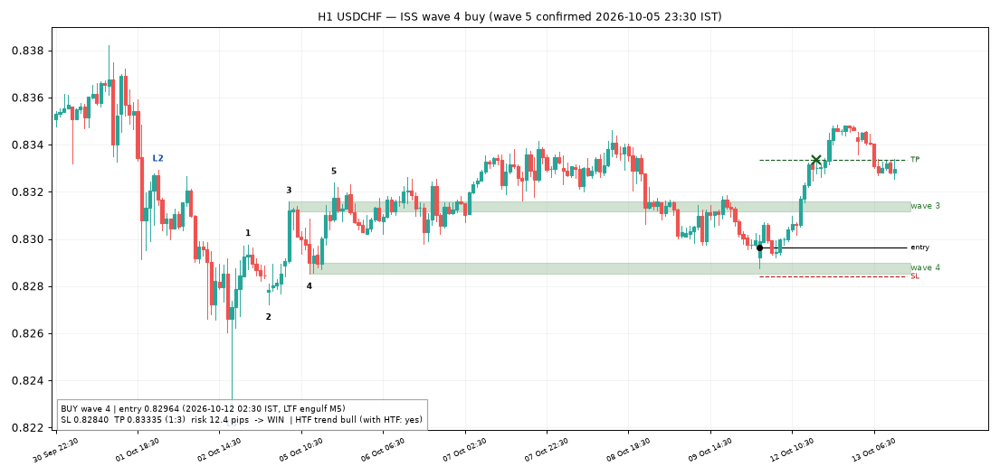
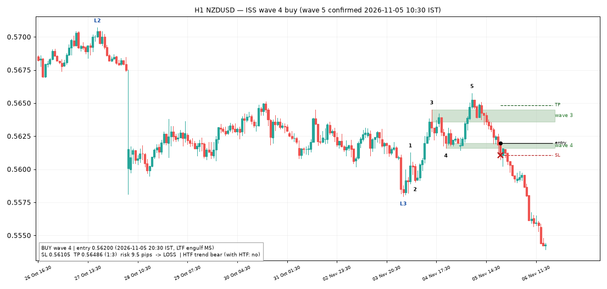
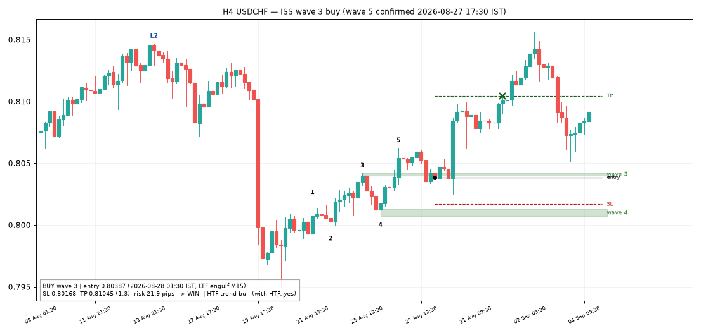
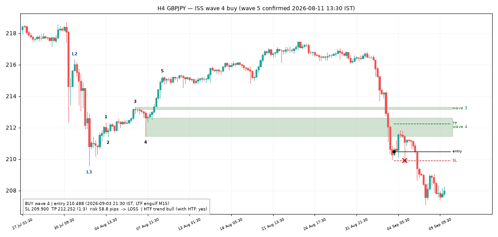

# 05 — Internal Structure Shift (5-wave CHOCH)

## Rules practised
- Inside the **last impulse** (level 2 → level 3), 5 waves form **against the trend** on the **same timeframe**, each wave confirmed with the 2-candle retracement rule.
- Wave 5 must be confirmed by its own 2-candle retracement and must NOT close beyond level 2 (that would be a normal CHOCH).
- Trade from the **wave 3** and **wave 4** zones (wick + 1% body). Course: works best on H1 and M15; never trade against the trend.

## How it was tested
- Pairs: AUDUSD, USDCAD, NZDUSD, EURJPY, USDCHF, GBPJPY (none on your watchlist). Data: Dukascopy bid, times in IST.
- Each setup is traded two ways: **raw** = limit order at the zone edge, SL beyond the zone (+0.1 ATR); **confirmed** = wait for price to touch the zone, then the first engulfing candle on the lower timeframe (D1→H1, H4→M15, H1→M5, M15→M1), market entry at its close, SL beyond the touch swing (+0.1 ATR).
- Target 1:3 (course examples ~1:3). A setup is cancelled if a candle closes through its invalidation level before entry. `hit1R%`/`hit2R%` = how often price reached 1R/2R before the stop (useful if you'd book earlier).
- Break-even win rate at 1:3 is 25%.

## Results by timeframe
| tf | method | trades | wins | losses | win% | net_R | R/trade | hit1R% | hit2R% |
|---|---|---|---|---|---|---|---|---|---|
| H1 | confirmed | 11 | 3 | 8 | 27.3 | 1.0 | 0.09 | 36.4 | 36.4 |
| H1 | raw | 20 | 1 | 19 | 5.0 | -16.0 | -0.8 | 25.0 | 15.0 |
| H4 | confirmed | 3 | 1 | 2 | 33.3 | 1.0 | 0.33 | 100.0 | 100.0 |
| H4 | raw | 5 | 1 | 4 | 20.0 | -1.0 | -0.2 | 20.0 | 20.0 |
| M15 | confirmed | 28 | 5 | 23 | 17.9 | -8.0 | -0.29 | 46.4 | 39.3 |
| M15 | raw | 31 | 5 | 26 | 16.1 | -11.0 | -0.35 | 19.4 | 19.4 |

## Results by zone
| tf | setup | method | trades | wins | losses | win% | net_R | R/trade | hit1R% | hit2R% |
|---|---|---|---|---|---|---|---|---|---|---|
| H1 | wave 3 | confirmed | 6 | 1 | 5 | 16.7 | -2.0 | -0.33 | 16.7 | 16.7 |
| H1 | wave 3 | raw | 11 | 0 | 11 | 0.0 | -11.0 | -1.0 | 9.1 | 9.1 |
| H1 | wave 4 | confirmed | 5 | 2 | 3 | 40.0 | 3.0 | 0.6 | 60.0 | 60.0 |
| H1 | wave 4 | raw | 9 | 1 | 8 | 11.1 | -5.0 | -0.56 | 44.4 | 22.2 |
| H4 | wave 3 | confirmed | 2 | 1 | 1 | 50.0 | 2.0 | 1.0 | 100.0 | 100.0 |
| H4 | wave 3 | raw | 3 | 0 | 3 | 0.0 | -3.0 | -1.0 | 0.0 | 0.0 |
| H4 | wave 4 | confirmed | 1 | 0 | 1 | 0.0 | -1.0 | -1.0 | 100.0 | 100.0 |
| H4 | wave 4 | raw | 2 | 1 | 1 | 50.0 | 2.0 | 1.0 | 50.0 | 50.0 |
| M15 | wave 3 | confirmed | 16 | 3 | 13 | 18.8 | -4.0 | -0.25 | 50.0 | 37.5 |
| M15 | wave 3 | raw | 16 | 1 | 15 | 6.2 | -12.0 | -0.75 | 12.5 | 12.5 |
| M15 | wave 4 | confirmed | 12 | 2 | 10 | 16.7 | -4.0 | -0.33 | 41.7 | 41.7 |
| M15 | wave 4 | raw | 15 | 4 | 11 | 26.7 | 1.0 | 0.07 | 26.7 | 26.7 |

## With vs against the higher-timeframe trend
| tf | with_htf | method | trades | wins | losses | win% | net_R | R/trade | hit1R% | hit2R% |
|---|---|---|---|---|---|---|---|---|---|---|
| H1 | no | confirmed | 7 | 0 | 7 | 0.0 | -7.0 | -1.0 | 14.3 | 14.3 |
| H1 | no | raw | 12 | 0 | 12 | 0.0 | -12.0 | -1.0 | 16.7 | 8.3 |
| H1 | yes | confirmed | 4 | 3 | 1 | 75.0 | 8.0 | 2.0 | 75.0 | 75.0 |
| H1 | yes | raw | 8 | 1 | 7 | 12.5 | -4.0 | -0.5 | 37.5 | 25.0 |
| H4 | no | raw | 2 | 1 | 1 | 50.0 | 2.0 | 1.0 | 50.0 | 50.0 |
| H4 | yes | confirmed | 3 | 1 | 2 | 33.3 | 1.0 | 0.33 | 100.0 | 100.0 |
| H4 | yes | raw | 3 | 0 | 3 | 0.0 | -3.0 | -1.0 | 0.0 | 0.0 |
| M15 | no | confirmed | 19 | 4 | 15 | 21.1 | -3.0 | -0.16 | 42.1 | 36.8 |
| M15 | no | raw | 19 | 3 | 16 | 15.8 | -7.0 | -0.37 | 15.8 | 15.8 |
| M15 | yes | confirmed | 9 | 1 | 8 | 11.1 | -5.0 | -0.56 | 55.6 | 44.4 |
| M15 | yes | raw | 12 | 2 | 10 | 16.7 | -4.0 | -0.33 | 25.0 | 25.0 |

## Example charts (confirmed entries; most recent wins and losses per timeframe)
### M15 NZDUSD — wave 3 buy — WIN
Setup 2026-10-19 11:30 IST · entry 0.56561 at 2026-10-19 11:45 · SL 0.56547 · TP 0.56603 · risk 1.4 pips · HTF trend bull

### M15 GBPJPY — wave 3 buy — LOSS
Setup 2026-11-13 13:00 IST · entry 211.483 at 2026-11-13 13:15 · SL 211.430 · TP 211.642 · risk 5.3 pips · HTF trend bull

### M15 NZDUSD — wave 4 buy — WIN
Setup 2026-09-24 11:15 IST · entry 0.56674 at 2026-09-24 15:15 · SL 0.56657 · TP 0.56725 · risk 1.7 pips · HTF trend bear

### M15 GBPJPY — wave 4 buy — LOSS
Setup 2026-11-13 13:00 IST · entry 211.483 at 2026-11-13 13:15 · SL 211.430 · TP 211.642 · risk 5.3 pips · HTF trend bull

### H1 USDCHF — wave 3 sell — WIN
Setup 2026-08-28 06:30 IST · entry 0.80497 at 2026-08-28 11:30 · SL 0.80532 · TP 0.80393 · risk 3.5 pips · HTF trend bear

### H1 NZDUSD — wave 3 buy — LOSS
Setup 2026-11-05 10:30 IST · entry 0.56428 at 2026-11-05 12:30 · SL 0.56350 · TP 0.56661 · risk 7.8 pips · HTF trend bear

### H1 USDCHF — wave 4 buy — WIN
Setup 2026-10-05 23:30 IST · entry 0.82964 at 2026-10-12 02:30 · SL 0.82840 · TP 0.83335 · risk 12.4 pips · HTF trend bull

### H1 NZDUSD — wave 4 buy — LOSS
Setup 2026-11-05 10:30 IST · entry 0.56200 at 2026-11-05 20:30 · SL 0.56105 · TP 0.56486 · risk 9.5 pips · HTF trend bear

### H4 USDCHF — wave 3 buy — WIN
Setup 2026-08-27 17:30 IST · entry 0.80387 at 2026-08-28 01:30 · SL 0.80168 · TP 0.81045 · risk 21.9 pips · HTF trend bull

### H4 GBPJPY — wave 3 buy — LOSS
Setup 2026-08-11 13:30 IST · entry 210.488 at 2026-09-03 21:30 · SL 209.900 · TP 212.252 · risk 58.8 pips · HTF trend bull

### H4 GBPJPY — wave 4 buy — LOSS
Setup 2026-08-11 13:30 IST · entry 210.488 at 2026-09-03 21:30 · SL 209.900 · TP 212.252 · risk 58.8 pips · HTF trend bull

Full trade log: `trades.csv` (one row per setup × entry method).
